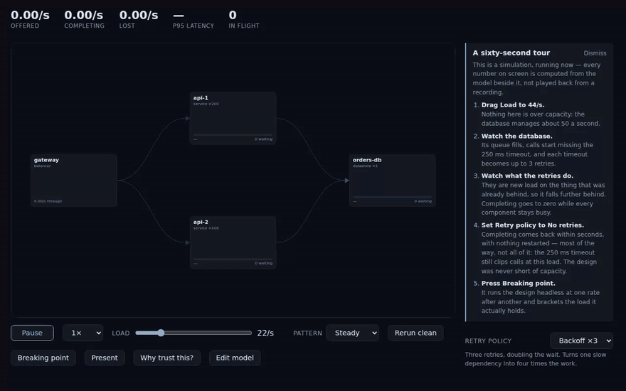

# Whiteboard That Runs

**A system-design diagram you can put load through.** Draw the system under discussion, give each box
two numbers, and watch which component fails first. Change a timeout, a retry policy, or the shape
of the traffic while it runs, and the whole room sees the consequence within seconds.

[](docs/demo.mp4)

*Thirty seconds of the built-in demo. Spiky traffic that averages 26 requests a second, half of what
the database can handle, sends the system into a retry storm it does not recover from on its own. Switching retries off
brings it back with the spikes still arriving. The last part runs a load pattern typed as a formula.
[Full-resolution video](docs/demo.mp4).*

## Why it exists

Design reviews argue about numbers: how many connections the pool needs, whether three retries is
too many, what happens when traffic doubles for a minute. The consequences of those numbers are
non-linear and hard to reason about at a whiteboard. In the built-in demo, a retry policy that is
harmless at 22 requests a second takes the system to zero throughput at 44, against a database that
handles 50. The component that turns red is often the victim of the one that failed.

This tool runs the diagram so the review can see those consequences instead of estimating them. It
computes what a system with the stated properties would do. It does not check that the properties
are correct, and it is not a capacity planner for a production system.

## Try it

```
npm install
npm run build      # produces dist/index.html, a single self-contained file
```

Open `dist/index.html` directly from disk. The app opens on a running example system with a short
tour beside it. `npm run dev` starts a development server, and `npm run package` produces a zip to
send to someone.

## What you can do

- **Draw a system** from load balancers, app servers, databases, in-memory stores, caches, queues
  with workers, and session pools. Each box asks two questions, **How many at once?** and **How
  long does one take?**, and shows the capacity they imply.
- **Run it and steer it live.** Drag the load, change a timeout, switch a retry policy, or turn off
  another team's traffic. Each change applies to the running simulation without a restart and
  appears as a chip under the canvas, and the whole session can be replayed exactly.
- **Shape the traffic.** Choose steady, spiky, or random load, or type a formula of your own. See
  [Load patterns](#load-patterns).
- **Find the breaking point.** One button brackets the sustained rate the design holds to, names
  the component where the trouble starts, and says so when a design has no clean threshold.
- **Compare a proposal.** Mark the components this month's proposal adds and get the breaking point
  with and without them, on identical traffic.
- **Check it against the textbook.** **Why trust this?** runs the same queueing-theory checks as the
  test suite, on screen.
- **Present it.** **Present** shows the canvas at full width with large figures for a meeting room.
- **Keep it private.** The page makes no network requests, so a model of a real system stays on the
  machine it was drawn on.

## Drawing your own

- **Start a model.** Choose **Edit model**, then **New…**. Pick a common shape (app servers and a
  database, a cache in front of a database, app servers sharing an in-memory store, or a queue and
  workers) or a blank canvas. Undo restores what was there before.
- **Answer two questions per box.** **How long does one take?** is the component's own work,
  excluding time spent waiting on anything downstream. Everything else is under **Details**.
- **Connect boxes.** Select a box, choose **Sends requests to…**, and click the box it sends to, or
  drag from one to the other. Arrowheads show the direction, and **Flip direction** reverses an arrow.
- **Say what an arrow means.** Click it and choose whether the sender passes the request on and
  waits, passes it on and moves on, or asks something along the way. Timeouts and retries are set on
  the arrow.
- **Mark what you know.** Every number starts as **assumed**. Typing a value marks it as stated, and
  one more click marks it as measured.
- **Run and steer.** Press **Run ▸**, then click a box to open its controls. The component that fails
  first opens on its own.
- **Save and open.** **Save** downloads the model as a `.whiteboard.json` file, and **Open…** loads
  one back. The browser asks before you close the page with unsaved changes.

## Load patterns

The **Pattern** menu next to the load slider sets how the load moves over time. The slider stays the
number being discussed, and the pattern describes the traffic around it.

| Pattern | What it does | Settings |
| --- | --- | --- |
| **Steady** | The slider's rate, all the time. | None |
| **Spiky** | The slider's rate, with a burst at the end of every period. | Spike height (× the load), how long it lasts, how often it comes |
| **Random** | A new rate every few seconds, drawn evenly within a band around the slider. It averages to the slider's rate. | Swing (±%), how long each rate holds |
| **Formula** | Any rate you can write as a function of time. | The formula |

Under the settings, a line states the average and peak rate the pattern produces over the next hour.
Patterns follow simulation time since the run started, so dragging the slider during a spiky run
changes the height of the spikes and leaves their timing alone. Random load comes from the run's seed,
so **Rerun clean** and a replay see the same traffic.

### Writing a formula

A formula gives requests per second at time `t`, in seconds since the run started. `base` is the
slider's value. The formula is read once a second, and a negative result counts as no traffic.

| Shape | Formula |
| --- | --- |
| A wave around the slider, once a minute | `base * (1 + 0.5 * sin(2 * pi * t / 60))` |
| A step to double the load after a minute | `t < 60 ? base : base * 2` |
| A two-second burst every thirty seconds | `t % 30 < 2 ? base * 4 : base` |
| A ramp from zero to the slider over two minutes | `base * min(1, t / 120)` |
| Square waves between two levels | `t % 40 < 20 ? base : base * 1.8` |

The language supports numbers, `t`, `base`, `pi` and `e`; the operators `+ - * / %` and `^` (or `**`)
for powers; comparisons, `&&`, `||`, `!` and `condition ? a : b`; and the functions `sin`, `cos`,
`tan`, `abs`, `min`, `max`, `floor`, `ceil`, `round`, `sqrt`, `exp`, `log` and `pow`. A `Math.` prefix
is accepted, so a formula copied from JavaScript still works.

Formulas are parsed by the app itself and are never executed as code. The page's security policy
forbids evaluating code, and a formula can only compute a number. A formula that produces a value
that is not a number, or a rate more than ten times the slider's maximum, is refused with the time at
which it happens, and the run keeps the load it had.

**Breaking point** is unaffected by the pattern. It always measures sustained steady rates, so its
answer means the same thing whichever pattern is on screen.

## Modelling reference

**Hand-offs and calls.** An arrow is either a hand-off or a call. Work travels along a hand-off and
continues from there. A call is a request the component makes and waits on, holding its own slot
until the answer arrives. Calls let a shared dependency such as a Redis instance or a primary
database be drawn once and called from many places, so its callers slow down together, as they do in
production. A component hands work on to exactly one place; any further arrows out of it are calls,
each with a count of calls per request. Calls are drawn as dashed ribbons.

**Timeouts and retries on a call.** Click a call and, under **If it is slow**, set a timeout and a
number of retries. An attempt the caller gives up on is abandoned but not cancelled: it stays queued
or in progress at the dependency while the retry joins the queue behind it. That duplicate work is
what drives a retry storm. Calls with a policy get a live control on the run screen.

**Leases.** Some components keep their slot after answering. A connection or session pool is the
usual case: a request claims a resource, gets a reply in seconds, and the resource stays allocated for
minutes. Set **Holds its slot** and a **Hold time**, and capacity is calculated from the hold time.

**Other traffic.** A shared component usually serves more than the path being modelled. Select a
component with nothing wired out of it, such as a datastore or a cache, choose **Add other traffic**,
and give it a name and a rate. That traffic occupies the component's servers, queue and lease, and is
kept out of the whole-path totals. Its rate is a live control, so "what if the batch job were not
running" takes one keystroke during a run.

**Proposals and disputed numbers.** Mark components as part of **this month's proposal** to get the
breaking point with and without them. Mark a number as **disputed** to get the answer across its
range. A difference smaller than the sweep's resolution is reported as no improvement.

## How the answers are checked

**The simulator agrees with queueing theory.** **Why trust this?** runs M/M/1 mean latency against
`1/(μ−λ)` for utilisation from 0.5 to 0.95, M/M/c against Erlang C up to eight servers, and Little's
Law at every node. The on-screen panel and the test suite share one code path and one budget: 10⁶
completions per point, with a warm-up sized from each point's relaxation time. Three self-check tests
confirm the suite can fail, by presenting it with an M/D/1 queue, a wrong server count, and a bounded
queue checked against the unbounded formula.

**Breaking point reports a range.** The sweep runs in a background worker at a series of steady rates
until it has bracketed the rate at which the system stops holding, for example "Holds to ~26/s. Folds
by 27.5/s." It stops at an 8% gap, the detector's measured resolution. It then re-runs the holding
rate on a different arrival stream; if that run fails, the readout says the design has no clean
threshold instead of quoting a number. It refuses a model it cannot sweep in a few seconds and shows
the calculation behind the refusal.

**The demo's claims are tests.** `src/ui/demo.test.ts` checks that the resting load holds across
three seeds, that 44 requests a second collapses, and that the recovery the tour describes is the
recovery the model produces. `scripts/capture-video.ts` checks the same arc while recording the
video above, and fails if the collapse or the recovery does not happen.

## No network access

The application is one HTML file whose content-security policy blocks every network destination.
You can verify this:

- `test/build-output.test.ts` builds the real file, opens it in Chromium over `file://` with every
  non-`file:` request blocked and recorded, exercises the demo, the editor, the validation suite and
  a breaking-point study, and checks that no request was attempted.
- A test checks that the security policy is the first element in the shipped file's `<head>` and
  contains no host sources or wildcards.
- `npm audit` reports no issues, and the build produces one file with nothing to fetch.

## What it can't model yet

- **Request classes.** Every request is treated the same, so there is no distinction between reads
  and writes, no per-tenant admission control, and no per-class SLA.
- **Retries on other traffic.** Other traffic has no call policy, so a retry storm driven mainly by
  load you did not draw cannot be modelled yet.
- **Fan-out as a distribution.** The number of calls per request is a single number. Where the tail
  is the problem, the mean produces a model that looks healthy and misses the failure.
- **More than one meaning of "done".** An asynchronous write has two endpoints, the reply the user
  waited for and the background work, and the readout reports the second.
- **Batching and parallel calls.** Dependencies are called one at a time, and nothing is batched.
- **Proposals that only add an arrow.** A proposal has to add a component.
- **Saved load patterns.** A pattern applies to the current session and is not stored in the model
  file.

Out of scope by design: circuit breakers and bulkheads, rate limiting, retry budgets and token
buckets, scatter-gather with a join, cache TTL and key space, autoscaling, and network latency on a
wire. Arrows take no time, so anything that costs time has to be drawn as a component.

## License

MIT. See [LICENSE](LICENSE).
